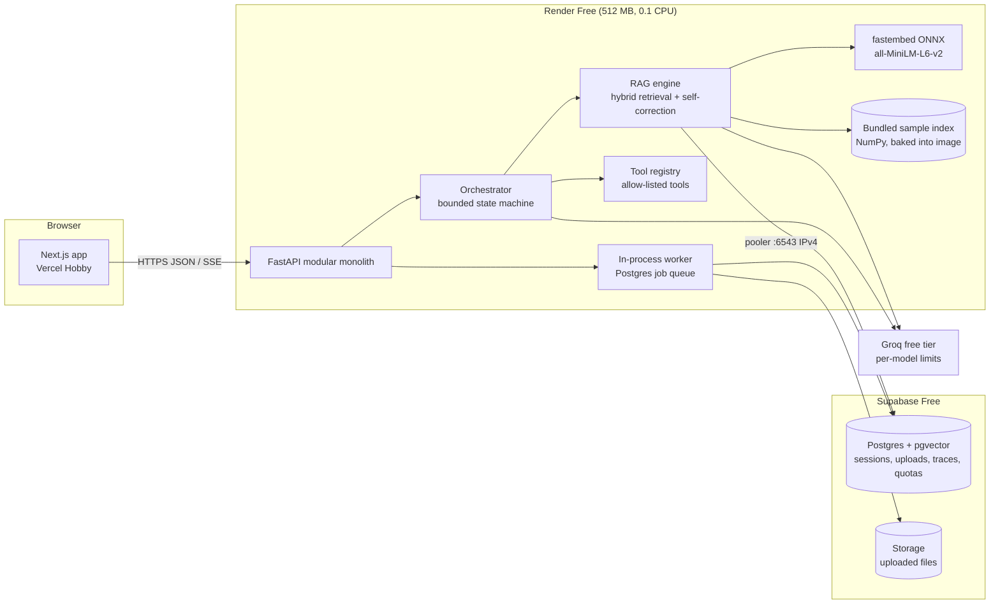

# Target Architecture

Status: **proposed** (2026-11-10). It replaces neither the code nor the README
until each phase lands. Service limits come from `FREE_TIER_SERVICE_MATRIX.md`.

## 1. Principles

1. **Evolve the existing seams; don't rewrite.** `Embedder`, `VectorStore`,
   `ChatClient` and `build_container` already isolate every backend. New
   capabilities are new implementations of these interfaces, plus a small number
   of new interfaces such as `Retriever` strategies, `Tool` and `Agent`.
2. **Modular monolith.** One FastAPI service with a single image and a single
   deploy. Split out a service only when a measured bottleneck justifies it.
3. **The EUR 0 constraints are design inputs, not afterthoughts.**
   - 512 MB RAM at 0.1 CPU.
   - Sleeping instances.
   - A database that pauses after 7 idle days.
   - LLM quotas of hundreds of requests per day.
4. **Degrade, don't fail.** The demo must answer sample questions even when the
   database is paused or the LLM quota is exhausted, with an honest status
   message.
5. **Never fabricate.** Metrics, scores and benchmark numbers shown anywhere come
   from real executions.

## 2. Target topology

## 3. Component map: current seam to target implementation

| Seam (exists today) | Target implementations | Phase |
| --- | --- | --- |
| `Embedder` | `SentenceTransformerEmbedder` (local dev, optional) + **`FastEmbedEmbedder`** (ONNX, deployment default) | 2 |
| `VectorStore` | `NumpyVectorStore`, `FaissVectorStore` (kept) + **`PgVectorStore`** (Supabase); `collection_id` + metadata filters | 2 |
| `Retriever` | Dense (current) + **BM25** (in-process for the bundled set; Postgres full-text for uploads) + **RRF fusion** + optional reranker | 2 |
| `ChatClient` | `OpenAICompatibleClient` (kept) + **`FallbackChatClient`** (ordered list of provider/model pairs, 429-aware) + per-call token/latency accounting | 2-3 |
| `SelfCorrectingRAGPipeline` | Kept as the RAG workflow, plus query rewriting on low context sufficiency and citation checking | 2-3 |
| (new) `Tool` | Typed schema, permission level, timeout, rate limit, audit record | 3 |
| (new) `Agent` / `Workflow` | Typed input/output, model config, step and token budgets, explicit states | 3 |
| `Container` | Also builds DB pools, quota guard, job worker; still the only place that wires concretions | 2-4 |

## 4. Key decisions

Each decision would move to `docs/decisions/` as an ADR when it is implemented.

**D1. The deployment embedder is fastembed (ONNX), not torch.** Render Free has
512 MB RAM, and torch plus sentence-transformers alone exceeds that (an
estimate, still to be measured). fastembed supports the same
`all-MiniLM-L6-v2` model, so the dimension and the quality profile stay the same.
torch remains available through the `local` extra.

**Acceptance for D1:** the container stays under 400 MB resident memory under
`docker run --memory=512m` during ingest and a 10-query burst. This is to be
measured, not assumed.

**D2. A curated sample index is baked into the image.** It is built at image
build time, using the existing NumPy store and atomic generation format. The
core demo (asking questions about sample documents) needs no database, so a
paused Supabase project or a cold start never breaks the first impression.
Uploads and history are the only features that need Supabase.

**D3. pgvector on Supabase goes through the shared pooler.**
- Free-tier direct connections are IPv6 only. Use the transaction pooler on
  port 6543 with psycopg 3 and server-side prepared statements disabled.
- Keep pools small (Supabase Nano allows 60 direct and 200 pooler clients).
- Store vectors with `vector(384)` and an HNSW index.

**D4. LLM routing uses Groq only for the public demo.**
- The Gemini free tier is excluded: its terms require Paid Services for users
  in the EEA, UK and Switzerland.
- Fallback means a second Groq model, because limits apply per model. The
  candidates are `qwen/qwen3.8-27b` (default) and `openai/gpt-oss-20b`; the
  latter needs `SCRAG_GUARDRAIL_MAX_TOKENS=256`.
- Ollama is for local development only.
- Model IDs are configuration, never constants. A startup probe of
  `GET /models` warns when a configured model is gone. That is exactly how the
  2026-08-16 retirement broke the old default.

**D5. No Redis.**
- Durable jobs, quotas and rate-limit counters live in Postgres (a jobs table
  claimed with `FOR UPDATE SKIP LOCKED`).
- Process memory holds only caches that are safe to lose.
- On Render Free there is exactly one instance, so in-process rate limiting is
  correct there. Postgres-backed counters are used once there are several
  instances.

**D6. Orchestration is a custom, bounded state machine, not LangGraph
(initially).**
- Workflows are explicit states: plan, then execute steps, then verify, then
  answer.
- They have hard limits on steps, tokens and wall time.
- Revisit LangGraph only if checkpointed human-in-the-loop graphs become a
  requirement that the custom engine can't meet cleanly.

**D7. Scope the agent roster to what the demo can run safely.**
- Start with Supervisor/Planner, Retrieval, Verification and Summarization.
- Document Analysis and Data Analysis (CSV/JSON via a pure-Python, allow-listed
  toolset) come later.
- Coding/Python-execution agents are **out of scope for the public demo**: no
  sandbox fits 512 MB and 0.1 CPU safely, and the project's safety rules forbid
  exposing arbitrary execution to visitors. They can exist behind an admin flag for local
  use.

**D8. Streaming uses Server-Sent Events.**
- Events cover tokens, retrieval results, attempt scores and agent state
  changes.
- SSE works through Vercel-to-Render with plain HTTP and needs no WebSocket
  infrastructure.

**D9. Demo identity is anonymous sessions.**
- A signed, short-lived session token is issued by the API.
- JWT verification (e.g. Supabase Auth) is added for the maintainer/admin and
  for optional sign-in.
- Full multi-organization RBAC is designed into the schema (`org_id` on every
  row) but not exposed in the demo UI until it has real users.

## 5. Data model sketch (Postgres, Phase 4)

`orgs`, `users`, `sessions` (anonymous or user, expiry), `collections`
(`org_id`, `visibility`), `documents` (`collection_id`, `source`,
`content_hash`, `version`, `status`), `chunks` (`document_id`, `position`,
`text`, `embedding vector(384)`, `tsv tsvector`, `metadata jsonb`),
`conversations`, `messages`, `executions` (`trace_id`, `workflow`, `status`,
`budget usage`), `execution_steps` (`agent`, `tool`, `input_hash`, `latency_ms`,
`tokens`, `error_code`), `evaluations`, `jobs` (`kind`, `payload`, `status`,
`attempts`, `run_after`), `usage_counters` (`subject`, `window`, `count`),
`audit_log`.

## 6. LLM budget model (why quotas are a first-class feature)

These are estimates from prompt sizes measured on 2026-11-10 (a guardrail call
with a short chunk was 102 prompt tokens on qwen) and default settings
(top_k=5, 1000-character chunks):

| Step | Calls | Approx. tokens |
| --- | --- | --- |
| Guardrail | 5 | 5 x ~350 = ~1.8K |
| Generate | 1-2 | ~1.5K each |
| Evaluate | 1-2 | ~1.5K each |
| **One query** | **7-9** | **~5K (one attempt) to ~8K (two)** |

Against the published Developer base limits for one model (8K TPM, 200K TPD,
1K RPD), that is roughly one full query per minute and a few dozen per day per
model. The free plan may be lower: its numbers aren't published. The demo
design therefore needs:
- cached answers for the curated sample questions;
- `top_k=5` in demo mode (3 until 2026-11-10; raised because k = 3 missed answers that k = 5 retrieves; measured cost about 2.5k tokens per self-corrected answer);
- one batched guardrail call instead of one call per chunk;
- per-session and global daily budgets;
- a clear "demo quota reached" state.

Phase 6 replaces these estimates with measured numbers.

## 7. Scaling targets (design targets, not capacity claims)

| Concurrent users | What has to change | Can it stay at EUR 0? |
| --- | --- | --- |
| A handful (demo) | The architecture above | Yes, within the quotas in section 6 |
| 100 | Paid LLM capacity or a self-hosted vLLM; an always-on API instance (no sleep); pgvector on a dedicated compute tier | No |
| 1,000 | Several stateless API instances behind a load balancer; Postgres-backed rate limits; a separate worker process; response caching; a read replica | No |
| 10,000 | Dedicated vector DB or partitioned pgvector; queue-based workers scaled separately; multi-provider LLM routing; CDN for static assets; SLOs and autoscaling | No |

Everything in the 1,000 and 10,000 rows has to be validated with load tests
(Phase 7) before any capacity is claimed.

## 8. Explicitly out of scope for now

- Microservices.
- Kubernetes.
- Paid observability SaaS.
- Arbitrary code execution for public visitors.
- Multimodal retrieval: images are only the input of an optional OCR step.
- Keep-alive pings that work around free-tier sleep or pause policies.
