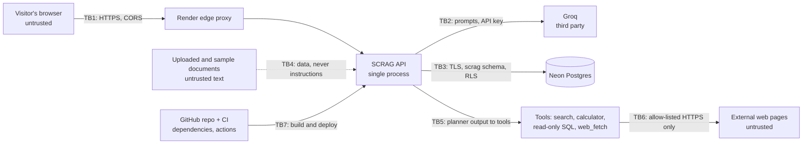

# Threat model

**Scope:** the SCRAG API, its CLI and persistence layer, the web UI, the public
demo (Render Free + Neon Free + Groq), and the repository's CI and supply chain.
**Method:** STRIDE, applied at each trust boundary. Every mitigation listed here
exists in the code and has a test; residual risks are stated, not hidden.
**Last reviewed:** 2026-11-10 (Phase 7). Report anything this misses privately,
as described in [SECURITY.md](../SECURITY.md).

## System and trust boundaries

| Boundary | What crosses it | Main concern |
| --- | --- | --- |
| TB1 | Every request from the internet | Abuse of a free service: cost, CPU, storage, other visitors' data |
| TB2 | Prompts (retrieved text, questions), the provider key | Quota exhaustion; provider sees prompts |
| TB3 | Sessions, uploads, history, jobs, counters | Cross-session access, injection, storage exhaustion |
| TB4 | Document text into prompts | Indirect prompt injection |
| TB5 | LLM-chosen tool names and inputs | The model is steered by the visitor: tools must be safe for any input |
| TB6 | URLs to fetch, pages fetched | SSRF, hostile responses |
| TB7 | Code, dependencies, GitHub Actions | Supply-chain compromise, leaked secrets |

## Assets

- **The provider key and quota** (`GROQ_API_KEY`; about 1000 requests/day and
  8000 tokens/minute on the free tier).
- **The operator token** (`SCRAG_API_AUTH_TOKEN`) and JWT admin rights.
- **Visitors' uploads, questions and history**, and their session tokens.
- **Free-tier capacity:** 0.1 CPU and 512 MB on Render, 0.5 GB on Neon.
- **The repository and its deploy path:** `main` deploys automatically.

## Actors

- **Anonymous visitor:** untrusted, possibly automated or malicious. Can call
  every public endpoint and steers the planner through the task text.
- **Document author:** anyone whose text ends up in an upload or a fetched
  page, and so in a prompt (indirect prompt injection).
- **The LLM:** its output is untrusted input to the parsers and the tools.
- **Operator:** holds the operator token; can ingest and read `/metrics` and
  `/admin/stats`.
- **Dependency or action author:** code that runs in CI or in the image.

## Threats and mitigations

### Spoofing

| ID | Threat | Mitigations | Residual risk |
| --- | --- | --- | --- |
| S1 | Impersonating the operator to ingest, read metrics or stats | Constant-time token comparison; JWT algorithms fixed by configuration (a token can't downgrade itself), `exp`/`sub`/`aud` required; on the demo, operator endpoints refuse anyone unproven (`require_operator`). Tests: `test_auth.py`, `test_observability.py` | A leaked operator token: rotate it in Render |
| S2 | Guessing or stealing a session token | 256 random bits, stored only as a SHA-256 hash; sent in a header, never a URL; 24 h fixed TTL; responses are `Cache-Control: no-store`. Tests: `test_persistence.py` | A token copied off the visitor's own device |
| S3 | Faking a client address to escape rate limits | Only the address appended by the trusted proxy (`SCRAG_FORWARDED_IP_HOPS` from the right) is used. Tests: `test_security.py` | Attackers with many real addresses (see D1, D2) |

### Tampering and elevation of privilege

| ID | Threat | Mitigations | Residual risk |
| --- | --- | --- | --- |
| T1 | Reading or changing another session's data | Every row hangs off `scrag.sessions`; every query filters on `session_id`; other sessions' resources answer 404 like missing ones; RLS on a non-public schema. Tests: `test_api_sessions_are_isolated_from_each_other` | None known |
| T2 | SQL injection into the persistence layer | Parameterized queries throughout; the only interpolated SQL is module constants (column lists, schema name) | None known |
| T3 | Prompt injection in a document triggers a tool | The planner sees only the visitor's task, never retrieved text or tool output, so text can't choose a tool. Evidence reaches the writer delimited as untrusted data, with tag-escape protection; the writer has no tools. Sensitive tools need explicit approval, and on the demo only the operator can approve. Tests: `test_orchestration.py` | Injected text can still bias an answer. The evaluator may not notice; answers cite their sources |
| T4 | The planner (steered by the visitor) writes hostile SQL for `sql_query` | A private in-memory SQLite copy of public index data; `PRAGMA query_only`; an authorizer that allows only SELECT, reads of the two catalog tables and an allow-list of pure functions (no `sqlite_master`, ATTACH, PRAGMA, recursion, `load_extension`, `randomblob`, `printf`, `group_concat`...); one statement; a 1 s progress-handler budget; row and value caps; SQLite length limits on Python 3.11+. Tests: `test_agent_tools.py` | None known for confidentiality or integrity; CPU bounded at about 1 s per call |
| T5 | The planner uses `web_fetch` for SSRF: cloud metadata, localhost, the internal network | Disabled unless the operator allow-lists hosts. Then: `https` on port 443 only; no credentials or IP literals in URLs; every resolved address must be public unicast (private, loopback, link-local, CGNAT, multicast, reserved, IPv4-mapped, 6to4, Teredo and NAT64 refused); the connection is pinned to the checked address with certificate verification for the host name (no DNS rebinding window); redirects re-checked at every hop (max 3); uncompressed text only, with size and time caps. Tests: `test_agent_tools.py` | An allow-listed host that turns hostile can serve misleading text (it is untrusted evidence, as in T3) |
| T6 | Code execution through the calculator | An AST walker over a whitelist of nodes and functions, never `eval`; exponent and result bounds; `round()` digits bounded (an unbounded negative value made Python compute 10**(10**9)). Tests: `test_orchestration.py`, `test_security.py` | None known |

### Repudiation

| ID | Threat | Mitigations | Residual risk |
| --- | --- | --- | --- |
| R1 | Abuse can't be traced afterwards | Request IDs on every response and log line; JSON logs on the demo; each tool call returns an audit record (input, status, latency); Prometheus counters for refusals | Visitors are anonymous by design: no accounts, no stored IP addresses |

### Information disclosure

| ID | Threat | Mitigations | Residual risk |
| --- | --- | --- | --- |
| I1 | Errors reveal paths, provider responses or stack traces | A sanitized error contract: a stable code, a client-safe message and a request ID; internals only in server logs; SSE `error` events use the same contract. Tests: `test_api_errors.py`, `test_streaming.py` | None known |
| I2 | Secrets leak through logs or `repr(settings)` | Keys only in the environment; `llm_api_key`, `api_auth_token`, `auth_jwt_secret` and `database_url` are excluded from the settings `repr`; GitHub secret scanning with push protection. Tests: `test_security.py` | A secret pasted into a log line by future code |
| I3 | Shared caches or browsers keep tokens or a visitor's data | `Cache-Control: no-store` on every API response (unless a route sets its own), `X-Content-Type-Options: nosniff`, a deny-all CSP on non-HTML responses, `Referrer-Policy: no-referrer`. Tests: `test_security.py` | None known |
| I4 | The LLM provider sees questions and uploads | Disclosed in the UI and README; uploads are not sent to providers with weaker data terms (ADR 0004); only retrieved chunks are sent | Accepted with disclosure |

### Denial of service

| ID | Threat | Mitigations | Residual risk |
| --- | --- | --- | --- |
| D1 | Draining the daily LLM budget | Per-client token bucket (6/min, burst 3) on expensive endpoints; **each client's share of the day is capped** (10 live runs; an agent run costs 2); global daily budget (30, persisted when a database is configured); recorded sample answers and a TTL cache; failed runs are refunded. Tests: `test_demo.py`, `test_security.py` | Many real addresses can still spend the global budget. Sample questions keep working when it's gone |
| D2 | A request flood exhausts the single process's CPU or the database | Per-endpoint rate limits on expensive endpoints, plus a cheap per-client flood guard on all requests (120/min, burst 60, health exempt), refused before routing; Render's edge proxy in front. Measured in [load-testing.md](load-testing.md): a one-client flood got 0.02% of its requests served on a rate-limited endpoint and 0.15% on an unlimited one (all of them without the guard), and no visitor request failed. Tests: `test_security.py` | A contained flood still roughly triples other visitors' median retrieval latency: one Python process can't fully isolate a busy connection. Volumetric attacks need edge protection |
| D3 | Huge request bodies buffered before validation | Every body is capped (64 KiB; uploads at their own limit, with a required `Content-Length`); a chunked body is counted while it streams. Tests: `test_security.py`, `test_workspace.py` | None known |
| D4 | Malicious uploads: zip bombs, parser bombs, binaries | The bytes must match the extension (`%PDF-` header; a DOCX must be a ZIP with `word/document.xml`); a DOCX's ZIP directory is checked before inflating (at most 30 MB inflated, 2,000 parts, a 200:1 ratio for parts over 1 MB); text with NUL bytes is refused; deep JSON and oversized CSV fields fail cleanly; PDFs are capped at 50 pages with a 30 s extraction budget (pypdf's own decompression limits apply); python-docx never resolves XML entities; chunk caps per document. Tests: `test_security.py`, `test_persistence.py` | One pathological PDF page can still run long: the budget is checked between pages |
| D5 | Filling the free database | Per-session document cap (5), global document cap (300), **global cap on live sessions (1,000)**, a per-document chunk cap, 24 h TTL with purge. Tests: `test_persistence.py` | Concurrent session creation can overshoot the cap by a few rows |
| D6 | Expensive tool inputs | Calculator bounds (T6); SQL budget (T4); fetch size and time caps (T5); every tool runs under a timeout in a worker thread | A timed-out thread can't be killed; each tool's own bound limits how long it keeps running |

### Supply chain and CI

| ID | Threat | Mitigations | Residual risk |
| --- | --- | --- | --- |
| C1 | A vulnerable dependency ships | `pip-audit` of the exact deployed dependency set and `npm audit` of production web dependencies in CI; Dependabot for pip, npm, GitHub Actions and the Docker base image; CodeQL | A vulnerability without a published fix |
| C2 | A compromised workflow or action abuses the token | The CI token is read-only (`permissions: contents: read`); only first-party actions (`actions/*`, `github/codeql-action`); `main` changes only through pull requests with passing checks | Compromise of a first-party action |
| C3 | A credential is committed | Secret scanning with push protection; `.env` is git-ignored | A secret in a format GitHub doesn't recognize |

## Out of scope

- Denial of service beyond what one free instance can absorb. The demo is a
  showcase on free tiers, not a hardened service.
- Vulnerabilities in Groq, Render, Neon or GitHub themselves.
- A compromised maintainer account.

## Keeping this current

Update this document in the same pull request as any change that adds an
endpoint, a tool, an external call or a new kind of stored data. The
[risk register](planning/RISK_REGISTER.md) tracks the open items.
